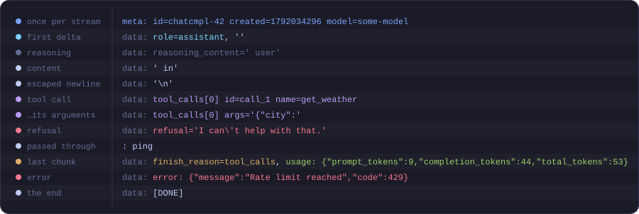
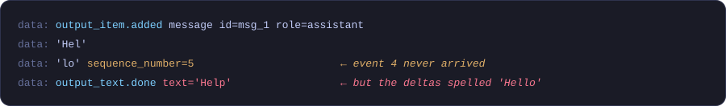
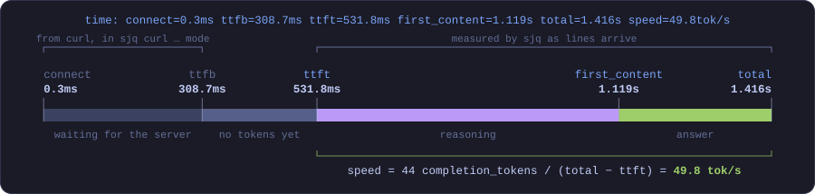

<div align="center">


**jq, but for AI streaming.**

Pipe an LLM stream in. Get the tokens out, one per line, and a stopwatch.

[](https://doc.rust-lang.org/edition-guide/rust-2024/)
[](#reading-the-output)
[](#responses-api)
[](Cargo.toml)

[Why](#why) · [jq parse error?](#jq-parse-error-invalid-numeric-literal) · [Install](#install) · [Usage](#usage) · [Reading the output](#reading-the-output) · [Responses API](#responses-api) · [Timing](#timing)

<br>



</div>

## Why

A streaming LLM response is mostly envelope. Every `data:` line repeats the id, the model,
the object type and a row of `null`s, just to deliver a few characters of new text:

| stream | on the wire | generated text | envelope |
|---|--:|--:|--:|
| chat completion, short answer | 3,590 B | 31 B | **99.1%** |
| chat completion, reasoning + answer | 10,446 B | 142 B | **98.6%** |
| Responses API, reasoning + answer | 24,726 B | 300 B | **98.8%** |

`jq` wants whole documents, and `grep` can't tell a reasoning token from an answer token. sjq
reads the stream as it arrives and keeps only what each event *adds*:

```diff
- data: {"id":"021792034294732770d3492782dd10cc0a489fec0a72ead7e3e0d","created":1792034296,"model":"viv-fast-2609","object":"chat.completion.chunk","system_fingerprint":null,"obfuscation":null,"choices":[{"delta":{"role":"assistant","reasoning_content":"The","refusal":null},"index":0,"logprobs":null}]}
+ meta: id=021792034294732770d3492782dd10cc0a489fec0a72ead7e3e0d created=1792034296 model=viv-fast-2609
+ data: role=assistant, reasoning_content='The'
- data: {"id":"021792034294732770d3492782dd10cc0a489fec0a72ead7e3e0d","created":1792034296,"model":"viv-fast-2609","object":"chat.completion.chunk","system_fingerprint":null,"obfuscation":null,"choices":[{"delta":{"reasoning_content":" user","refusal":null},"index":0,"logprobs":null}]}
+ data: reasoning_content=' user'
- data: {"id":"021792034294732770d3492782dd10cc0a489fec0a72ead7e3e0d","created":1792034296,"model":"viv-fast-2609","object":"chat.completion.chunk","system_fingerprint":null,"obfuscation":null,"choices":[{"delta":{"content":"Hola","refusal":null},"index":0,"logprobs":null}]}
+ data: 'Hola'
- data: {"id":"021792034294732770d3492782dd10cc0a489fec0a72ead7e3e0d","created":1792034296,"model":"viv-fast-2609","object":"chat.completion.chunk","system_fingerprint":null,"obfuscation":null,"choices":[{"delta":{"refusal":null},"finish_reason":"stop","index":0,"logprobs":null}],"usage":{"prompt_tokens":232,"completion_tokens":44,"total_tokens":276,"prompt_tokens_details":{"audio_tokens":0,"cached_tokens":0},"completion_tokens_details":{"accepted_prediction_tokens":0,"audio_tokens":0,"reasoning_tokens":24,"rejected_prediction_tokens":0}}}
+ data: finish_reason=stop, usage: {"prompt_tokens":232,"completion_tokens":44,"total_tokens":276,"completion_tokens_details":{"reasoning_tokens":24}}
  data: [DONE]
+ time: connect=0.3ms ttfb=308.7ms ttft=531.8ms first_content=1.119s total=1.416s speed=49.8tok/s
```

## jq: parse error: Invalid numeric literal

Searched for this error? You piped a streaming response into `jq`:

```console
$ curl -i "$BASE_URL/v1/chat/completions" -d '{"stream":true, …}' | jq
jq: parse error: Invalid numeric literal at line 1, column 9
```

With `"stream": true` the response isn't one JSON document. It's
[Server-Sent Events](https://developer.mozilla.org/en-US/docs/Web/API/Server-sent_events/Using_server-sent_events):
`data: {…}` lines (plus `event: …` lines on `/v1/responses`), separated by blank lines and
ended by `data: [DONE]`. jq gives up at the first word that isn't JSON, and the column
tells you which word it was:

| the input starts with | jq says |
|---|---|
| `HTTP/1.1 200 OK`, the status line from `curl -i` | `jq: parse error: Invalid numeric literal at line 1, column 9` |
| `data: {"id":…`, a `/v1/chat/completions` chunk | `jq: parse error: Invalid numeric literal at line 1, column 5` |
| `event: response.created`, a `/v1/responses` event | `jq: parse error: Invalid numeric literal at line 1, column 6` |

The fix is one word: put `sjq` where `jq` was. Headers from `-i` pass through untouched.

```sh
curl -iN "$BASE_URL/v1/chat/completions" … | sjq
```

Rather stay in jq? Read the lines raw, strip `data: ` and skip whatever isn't JSON:

```sh
curl -sN "$BASE_URL/v1/chat/completions" … | jq -cR 'ltrimstr("data: ") | fromjson? // empty'
```

That gets you valid JSON again, but still a few hundred bytes of envelope per token.

## Install

```sh
brew tap vivgrid/tap && brew trust vivgrid/tap  # Homebrew 6+ asks you to trust third-party taps; once is enough
brew install sjq
```

Or build from source:

```sh
cargo install --git https://github.com/vivgrid/sjq
```

One binary, one dependency (`serde_json`). Needs a recent stable Rust (edition 2024).

## Usage

| run | what you get |
|---|---|
| `sjq curl …` | sjq runs curl for you, so the `time:` line also gets connect, TLS and TTFB |
| `curl -sN … \| sjq` | pipe in any stream (`-N` stops curl from buffering it) |
| `sjq capture.txt` | replay a saved stream, or several |

```sh
sjq curl -s "$BASE_URL/v1/chat/completions" \
  -H "Authorization: Bearer $API_KEY" -H 'Content-Type: application/json' \
  -d '{"model":"'"$MODEL"'","stream":true,"messages":[{"role":"user","content":"hi"}]}'
```

`-t` prefixes each line with the seconds since start, handy for spotting stalls.
`--color auto|always|never` sets coloring, and `NO_COLOR` is honored.

## Reading the output



- **Text is quoted and escaped**, so leading spaces, empty deltas (`''`) and newlines are
  visible, and every chunk stays on one line.
- **Reasoning keeps the provider's field name**: `reasoning_content`, `reasoning`,
  `reasoning_details`, whatever the server sends.
- **`meta:` appears once per stream**, and again only when `id`, `model` or anything else
  in the envelope changes.
- **`usage` drops zero counters** inside `*_details`.
- **Nothing unusual is hidden.** Unrecognized non-null fields print as `key=value`, and
  non-`data:` lines (`event:`, `: ping`, a plain-text error body) pass through. The only
  lines dropped are blank lines and `event:` lines that repeat the next payload's `type`.

## Responses API

`/v1/responses` streams typed events instead of chunks. sjq drops the `response.` prefix
from event names and prints answer text the same way as chat content:

```text
meta: created_at=1792038227 id=resp_0217… model=… reasoning={"effort":"medium"} service_tier=auto
data: created status=in_progress
data: output_item.added reasoning id=rs_0217… status=in_progress
data: reasoning_summary_text='Simple'
data: reasoning_summary_text.done
data: output_item.added message role=assistant status=in_progress id=msg_0217…
data: content_part.added output_text
data: 'Here'
data: output_text.done
data: output_item.done message status=completed
data: completed, usage: {"input_tokens":18,"output_tokens":87,"output_tokens_details":{"reasoning_tokens":3},"total_tokens":105}
```

The Responses API repeats itself a lot. Every `.done` event echoes the full text again, at
every level (text, part, item, response), and every event carries a `sequence_number`.
sjq checks instead of printing: an echo that matches the deltas is hidden, and so is a
`sequence_number` that is one more than the last. You only see them when something is off:



`item_id`, `output_index`, `content_index` and `summary_index` work the same way: they only
show when they change, for example when two function calls stream at once.

## Timing

When the stream ends, sjq prints one more line:



| field | meaning |
|---|---|
| `connect` `tls` `ttfb` | from curl, only with `sjq curl …` |
| `ttft` | first generated token: reasoning, content or tool call |
| `first_content` | first answer token, shown when reasoning or a tool call came first |
| `total` | last line received |
| `speed` | `completion_tokens` (or `output_tokens`) `/ (total − ttft)` |

A pipe only carries the response body. With `curl … | sjq`, sjq counts from its own start,
which is when the shell started curl, but it can't see the TCP connect. `sjq curl …` adds
`-N -sS -w …` to your curl arguments (replacing any `-w` of yours) to get connection
timings, and exits with curl's status. Replayed files get no `time:` line.

<br>

<div align="center">

<code>data: [DONE]</code>

</div>
